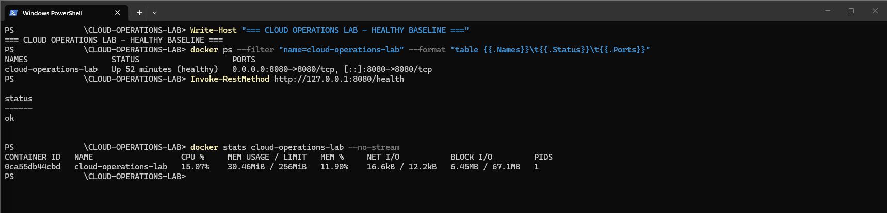
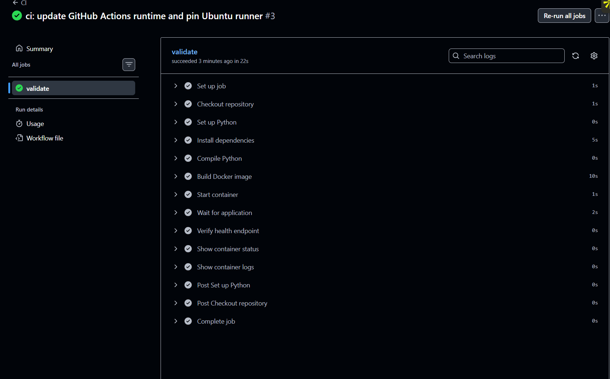

# Cloud Operations Lab

[](https://github.com/wandersonr7/CLOUD-OPERATIONS-LAB/actions/workflows/ci.yml)
[](LICENSE)

Cloud Operations Lab is a hands-on troubleshooting and incident-response environment designed to practice Linux, containers, networking, monitoring, logging, and cloud operations.

The project intentionally creates operational failures and documents how to investigate, identify, fix, verify, and prevent them.

## At a Glance

- **9 incidents**, each with a full root-cause report: ports, health checks, restart loops, CPU, memory, disk, DNS, internal networking and network exposure.
- **Every incident is reproducible with one command.** `chaos/lab.sh drill 04` breaks the service, proves the failure is detectable, applies the fix and re-verifies every operational signal.
- **CI replays all 9 incidents on every push.** Each one runs as its own GitHub Actions job: break → detect → fix → verify.

```bash
bash chaos/lab.sh drill 07
```

```text
[lab] drill 07: DNS resolution failure
[lab] starting healthy baseline
[ ok ] baseline healthy
[lab] injecting failure
[ ok ] failure signal detected
[lab] applying resolution
[ ok ] host -> /health reachable
[ ok ] docker health: healthy
[ ok ] published on 127.0.0.1 only
[ ok ] cpu below 50%
[ ok ] memory below 150 MiB
[ ok ] /var/log below 50 MiB
[ ok ] dns resolves example.com
[ ok ] drill 07 passed (detected in 2s)
```

## Portfolio Highlights

- 9 documented infrastructure, application and security incidents
- One-command reproducible incident drills, replayed in CI
- Docker and Docker Compose troubleshooting
- Linux process and resource investigation
- DNS, TCP, HTTP, and service-discovery diagnostics
- CPU, memory, disk, and log-pressure analysis
- Health-check and restart-loop troubleshooting
- GitHub Actions CI validation
- Reproducible root-cause analysis and recovery verification

## Purpose

Many infrastructure projects demonstrate how to deploy a service.

This lab focuses on what happens when the service stops working, when infrastructure reports an incorrect operational state, or when the application remains available while the underlying system is degraded.

Each scenario follows an incident-response workflow:

```text
Incident
   |
   v
Symptoms
   |
   v
Investigation
   |
   v
Root Cause
   |
   v
Resolution
   |
   v
Verification
   |
   v
Prevention
```

## Current Lab Service

The lab runs a small Flask application inside Docker.

Endpoints:

```text
GET /
GET /health
```

Healthy response:

```json
{
  "status": "ok"
}
```

Normal request path:

```text
Client
   |
   v
localhost:8080
   |
   v
Docker published port
   |
   v
Container :8080
   |
   v
Flask application
```

Docker also monitors the service with a health check.



The container currently has a memory limit of:

```text
256 MiB
```

## Incident Progress

| Incident | Scenario | Status |
|---|---|---|
| 01 | Service unreachable due to incorrect Docker port mapping | Completed |
| 02 | Container health check failure | Completed |
| 03 | Application process failure and restart loop | Completed |
| 04 | High CPU usage | Completed |
| 05 | Memory pressure | Completed |
| 06 | Log growth and disk pressure | Completed |
| 07 | DNS resolution failure | Completed |
| 08 | Internal network connectivity failure | Completed |
| 09 | Service exposed on all network interfaces | Completed |

## Completed Incidents

### Incident 01 — Service Unreachable Due to Incorrect Docker Port Mapping

The application was healthy inside the container but unreachable from the host.

Observed:

```text
Host 8080 -> Container 8081
```

Root cause:

```text
Incorrect Docker Compose port mapping
```

Full report:

[Incident 01 — Service Unreachable Due to Incorrect Docker Port Mapping](incidents/01-service-unreachable-wrong-port.md)

---

### Incident 02 — Container Health Check Failure

The application remained available while Docker reported the container as unhealthy.

Docker was checking:

```text
127.0.0.1:9999/health
```

while Flask was listening on:

```text
127.0.0.1:8080
```

Root cause:

```text
Incorrect health-check port
```

Full report:

[Incident 02 — Container Health Check Failure](incidents/02-container-healthcheck-failure.md)

---

### Incident 03 — Application Process Failure and Restart Loop

Docker repeatedly restarted the container because the configured application entrypoint did not exist.

Logs showed:

```text
python: can't open file '/app/app/missing.py'
```

Root cause:

```text
Invalid application entrypoint
```

After remediation:

```text
Container status: healthy
Application health: ok
RestartCount: 0
```

Full report:

[Incident 03 — Application Process Failure and Restart Loop](incidents/03-application-process-restart-loop.md)

---

### Incident 04 — High CPU Usage

The application remained healthy while CPU utilization reached approximately:

```text
99.82%
```

Process-level investigation identified a background Python process executing:

```python
while True:
    pass
```

After terminating it:

```text
CPU: 0.01%
PIDS: 1
Application health: ok
```

Full report:

[Incident 04 — High CPU Usage](incidents/04-high-cpu-usage.md)

---

### Incident 05 — Memory Pressure

The container memory limit was:

```text
256 MiB
```

During the incident:

```text
Memory: 213.3 MiB / 256 MiB
Usage: 83.31%
Application health: ok
```

After identifying and terminating the memory-consuming process:

```text
Memory: 28.97 MiB / 256 MiB
Usage: 11.32%
Application health: ok
```

Full report:

[Incident 05 — Memory Pressure](incidents/05-memory-pressure.md)

---

### Incident 06 — Log Growth and Disk Pressure

A simulated log file grew to:

```text
64M
```

The `/var/log` directory increased from:

```text
212K
```

to:

```text
65M
```

Docker reported the writable layer growing to:

```text
67.1MB
```

After cleanup:

```text
/var/log:       212K
Writable layer: 20.5kB
Application:    healthy
```

Full report:

[Incident 06 — Log Growth and Disk Pressure](incidents/06-log-growth-disk-pressure.md)

---

### Incident 07 — DNS Resolution Failure

The container lost hostname resolution while general TCP connectivity remained functional.

During the failure:

```text
DNS           FAIL
TCP           OK
Application   OK
```

The resolver had been changed from Docker's internal resolver:

```text
127.0.0.11
```

to a non-functional nameserver.

After restoration:

```text
DNS           OK
TCP           OK
Application   OK
Container     healthy
```

Full report:

[Incident 07 — DNS Resolution Failure](incidents/07-dns-resolution-failure.md)

---

### Incident 08 — Internal Network Connectivity Failure

A dependency container remained running and resolvable through Docker DNS, but its service stopped listening on TCP port `9090`.

Baseline:

```text
DNS          OK
TCP :9090    OK
HTTP         200
Main app     OK
```

After the dependency HTTP process was terminated:

```text
Container dependency   running
DNS                    OK
TCP :9090              FAIL
Main app               OK
```

The observed TCP error was:

```text
ConnectionRefusedError: [Errno 111] Connection refused
```

Process inspection showed that:

```text
python -m http.server 9090
```

was no longer running.

The container itself remained alive because:

```text
tail -f /dev/null
```

continued running.

This demonstrated:

```text
Container running != Service listening
```

The service was restarted and verified:

```text
DNS          OK
TCP :9090    OK
HTTP         200
Main app     OK
```

The temporary dependency container was removed after the test.

Full report:

[Incident 08 — Internal Network Connectivity Failure](incidents/08-network-connectivity-failure.md)

---

### Incident 09 — Service Exposed on All Network Interfaces

A review of running services found the lab published on every host interface. All health signals were green: the problem was exposure, not availability.

Observed:

```text
8080/tcp -> 0.0.0.0:8080
8080/tcp -> [::]:8080
```

Root cause:

```text
Compose mapping "8080:8080" binds to 0.0.0.0 when no host IP is given
```

After restricting the binding to `127.0.0.1:8080:8080`:

```text
8080/tcp -> 127.0.0.1:8080
Application health: ok
```

This demonstrated:

```text
Health check ok != Safely exposed
```

Full report:

[Incident 09 — Service Exposed on All Network Interfaces](incidents/09-service-exposed-all-interfaces.md)

## Reproducible Incident Drills

Every incident can be replayed on demand with `chaos/lab.sh` (Git Bash on Windows, any shell on Linux/macOS):

```bash
bash chaos/lab.sh list          # list incidents
bash chaos/lab.sh up            # start healthy baseline
bash chaos/lab.sh break 05      # inject memory pressure
bash chaos/lab.sh detect 05     # confirm the failure signal
bash chaos/lab.sh fix 05        # apply the documented resolution
bash chaos/lab.sh verify        # check every operational signal
bash chaos/lab.sh drill 05      # all of the above, end to end
```

With `make`: `make drill-05`, `make drill-all`.

How each failure is injected:

| Incident | Injection |
|---|---|
| 01 | Compose override maps host `8080` to container `8081` |
| 02 | Compose override points the health check at port `9999` |
| 03 | Compose override sets the entrypoint to `app/missing.py` |
| 04 | Busy-loop Python process inside the container |
| 05 | Process allocating 180 MiB under a 256 MiB limit |
| 06 | 64 MiB log file written to `/var/log` |
| 07 | `/etc/resolv.conf` pointed at an unreachable nameserver |
| 08 | Dependency container whose HTTP process is killed |
| 09 | Compose override publishes the port on `0.0.0.0` |

The `verify` step checks host reachability, Docker health, loopback-only binding, CPU, memory, log size and DNS. A drill passes only when the failure is detected **and** every signal returns to baseline.

## Troubleshooting Method

Each incident is investigated layer by layer.

```text
Application
    |
    v
Process
    |
    v
Container
    |
    v
DNS
    |
    v
Network
    |
    v
TCP Port
    |
    v
HTTP
    |
    v
Client
```

Resource incidents add:

```text
Operational Health
       |
       +--> Availability
       +--> CPU
       +--> Memory
       +--> Disk
       +--> DNS
       +--> Network
       +--> Logs
```

Different signals must be evaluated independently.

```text
Application health != Container health
Container running   != Application running
Health endpoint ok  != CPU usage normal
Health endpoint ok  != Memory usage normal
Health endpoint ok  != Disk usage normal
DNS failure         != Network outage
Container running   != Service listening
```

## Continuous Integration

GitHub Actions validates the project automatically on pushes to `main` and on pull requests.

The workflow performs:

```text
Checkout repository
        |
        v
Configure Python 3.12
        |
        v
Install dependencies
        |
        v
Compile Python application
        |
        v
Build Docker image
        |
        v
Start container with memory limit
        |
        v
Wait for application
        |
        v
Verify /health
        |
        v
Collect container status and logs
```

A second job, `incident-drills`, runs after validation. It replays all 9 incidents in parallel, one job per incident, using `chaos/lab.sh drill <id>`.

The CI workflow is located at:

```text
.github/workflows/ci.yml
```



## Technologies

Current technologies:

- Python 3.12
- Flask
- Docker
- Docker Compose
- GitHub Actions
- Linux process inspection
- Linux PID namespaces
- `/proc`
- filesystem inspection
- DNS troubleshooting
- TCP connectivity testing
- HTTP connectivity testing
- Docker service discovery
- container resource limits
- Git
- PowerShell

## Commands Practiced

The lab uses operational commands including:

```text
docker ps
docker logs
docker inspect
docker exec
docker top
docker stats
docker ps -s
df
du
ls
cat
/proc
socket.gethostbyname
socket.create_connection
Invoke-RestMethod
```

## Run the Lab

Build and start:

```bash
docker compose up -d --build
```

Check container state:

```bash
docker ps
```

Test health:

```bash
curl http://127.0.0.1:8080/health
```

Windows PowerShell:

```powershell
Invoke-RestMethod http://127.0.0.1:8080/health
```

Inspect resources:

```bash
docker stats cloud-operations-lab --no-stream
```

Inspect processes:

```bash
docker top cloud-operations-lab
```

Inspect filesystem:

```bash
docker exec cloud-operations-lab df -h /
```

Inspect DNS:

```bash
docker exec cloud-operations-lab cat /etc/resolv.conf
```

Inspect logs:

```bash
docker logs cloud-operations-lab
```

Stop:

```bash
docker compose down
```

## Current Resource Controls

The lab currently uses:

```yaml
mem_limit: 256m
```

This limits the impact of memory experiments on the host system.

## Project Structure

```text
CLOUD-OPERATIONS-LAB/
|
+-- .github/
|   +-- workflows/
|       +-- ci.yml
|
+-- app/
|   +-- main.py
|
+-- chaos/
|   +-- lab.sh
|   +-- overrides/
|
+-- incidents/
|   +-- 01-service-unreachable-wrong-port.md
|   +-- 02-container-healthcheck-failure.md
|   +-- 03-application-process-restart-loop.md
|   +-- 04-high-cpu-usage.md
|   +-- 05-memory-pressure.md
|   +-- 06-log-growth-disk-pressure.md
|   +-- 07-dns-resolution-failure.md
|   +-- 08-network-connectivity-failure.md
|   +-- 09-service-exposed-all-interfaces.md
|
+-- docs/
|   +-- images/
|
+-- Dockerfile
+-- docker-compose.yml
+-- Makefile
+-- requirements.txt
+-- .gitignore
+-- LICENSE
+-- README.md
```

## Incident Documentation Standard

Each incident contains:

```text
1. Summary
2. Impact
3. Expected behavior
4. Symptoms
5. Investigation
6. Commands used
7. Root cause
8. Resolution
9. Verification
10. Prevention
```

## Skills Demonstrated

This lab demonstrates practical work with:

- Linux troubleshooting
- container troubleshooting
- Docker networking
- Docker DNS
- service discovery
- TCP connectivity
- HTTP connectivity
- port publishing
- Docker health checks
- application health checks
- process troubleshooting
- restart loops
- CPU troubleshooting
- memory troubleshooting
- filesystem troubleshooting
- log growth analysis
- container resource limits
- Linux PID namespaces
- `/proc` inspection
- CI/CD validation
- root-cause analysis
- incident response
- operational documentation
- Git-based project management

## Portfolio Goal

This repository demonstrates troubleshooting skills relevant to roles such as:

- Cloud Support Engineer
- Junior Cloud Engineer
- DevOps Engineer
- Systems Administrator
- Infrastructure Support Engineer
- Site Reliability Engineering intern or junior roles

The focus is not only on building systems, but on diagnosing failures methodically and proving recovery with observable evidence.

## Status

**Cloud Operations Lab v1 incident series complete. All incidents reproducible and replayed in CI.**

Completed incidents:

```text
9 / 9
```

CI status:

```text
GitHub Actions: passing
```

License:

```text
MIT
```